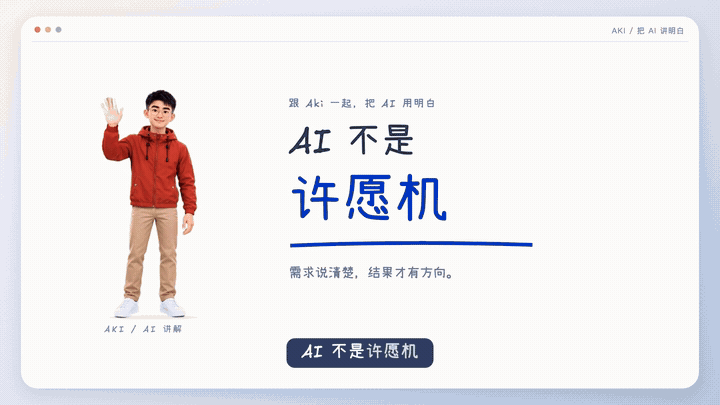

# 用自己的卡通 IP 做讲解动画

把透明角色图片或一套动作放进 Remotion，配上口播、字幕和图解，输出可编辑工程与 MP4。



## 先跑起来

需要 Node 24、Python 3.10+、FFmpeg。用 Codex 或 Claude Code 打开本目录，读取 SKILL.md 即可；也可以直接运行下面的命令。

1. 克隆仓库：`git clone https://github.com/akiai666/aki-ai-skills.git`。
2. 到 [Releases](https://github.com/akiai666/aki-ai-skills/releases/tag/aki-remotion-explainer-v1.0.0) 下载 `aki-motion-v1.0.0.zip` 并解压。
3. 在 Skill 目录初始化工程，选择动作，渲染第一段预览：

```sh
cd aki-ai-skills/skills/aki-remotion-explainer
node scripts/new-project.ts /path/to/my-video   --ip-dir /path/to/aki-motion-v1.0.0   --actions wave,think --allow-draft-actions
cd /path/to/my-video/video
npm ci
npm run timeline
npm run lint
npm run render
```

把 `/path/to/...` 换成自己的目录。输出在 `video/out/`。第一段是 6 秒无声预览，展示所选的第一个动作；完整讲解需要提供稿件、配音，再由 AI 编排场景。

可以直接对 AI 说：

> 读取 aki-remotion-explainer 的 SKILL.md。用我下载的动作包做一段 30 秒知识讲解视频，横屏，选择 wave、think、approve。稿件和配音我会提供，先用现有素材，不生成新图片或视频。素材还在试用阶段，按评审工程导入。

## 换成自己的形象

已有透明全身图时，把它命名为 `idle.png`，放在单独目录：

```sh
node scripts/new-project.ts /path/to/my-video --ip-dir /path/to/my-character
```

这一步能导入自己的角色；更多姿势和连续动作需要另外制作。通用提示词见 [prompts/actions.md](prompts/actions.md)，视频转透明帧方法见 [references/video-actions.md](references/video-actions.md)。目前没有“上传照片自动生成整套动作”的按钮。

## 素材包与复用

示例包包含 **48 张透明姿势、6 段连续动作**，每段 5 秒、24fps，附 PNG 序列、透明 WebM、MP4 预览和提示词。6 段是挥手、讲解、思考、点赞、惊讶、扶额；其余目前是单图姿势。

手部接触没有逐帧追踪，卡片、桌子等道具需独立摆放；动作仍保留试用状态，所以示例命令使用 `--allow-draft-actions`。没有标定无缝循环。

主库只维护一份。新视频仅复制所选动作并记录文件哈希，更新主库不影响旧工程；本机默认目录、刷新图库和导出素材包见 [references/library.md](references/library.md)。

## 来源与许可

代码基于 [Jackywxsz/jacky-remotion-skill](https://github.com/Jackywxsz/jacky-remotion-skill) 的 MIT 版本 `8f6e879` 改造，使用自有角色与程序绘制底图，未包含芽仔及原品牌图片。视频抠像思路参考 [Oil Motion](https://github.com/oil-oil/oil-motion)。

代码与通用提示词采用 MIT；示例 Aki 角色素材按下载包中的 ASSETS-LICENSE.md 使用，角色身份与声音不随代码授权。字体保留 OFL，Remotion 使用自身 [许可](https://www.remotion.dev/license)，详见 [第三方声明](THIRD-PARTY-NOTICES.md)。
